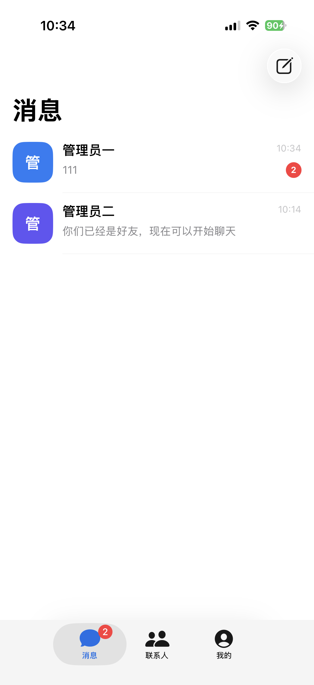
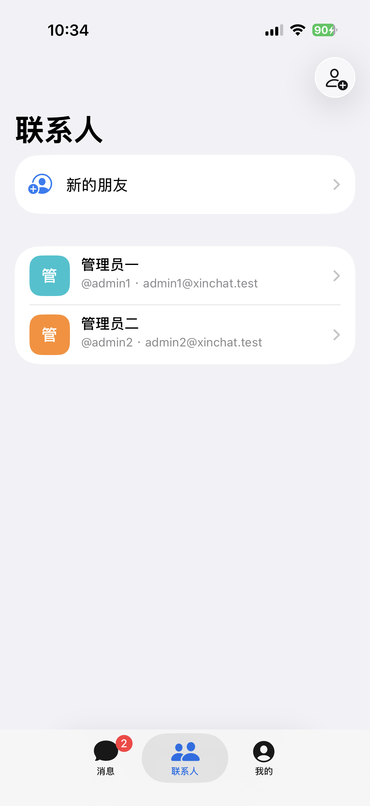
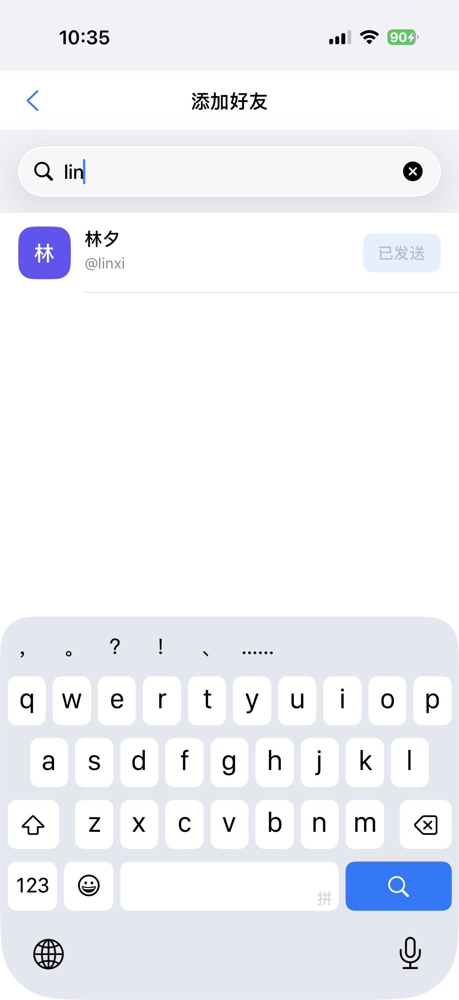

<div align="center">
  

  # XinChat Swift

  A messaging app learning project built with Swift, UIKit, and MVVM.

  English · [简体中文](README.md)
</div>

## Overview

XinChat is an open-source iOS messaging app under active development. It demonstrates project organization commonly used in production applications: MVVM for screen state, repositories for data-source isolation, dependency injection for module composition, and centralized networking and reusable UI components.

The current version includes account login, a conversation list, chat detail, remote contacts, an add-friend flow, and profile screens. It can be used as a starting point for a UIKit messaging app or as a practical architecture reference.

> If you find this project helpful, consider giving it a Star. Feedback and improvement suggestions are always welcome.

## 📱 Project View

<table>
  <tr>
    <td></td>
    <td></td>
    <td></td>
  </tr>
</table>

## Features

- Three-tab interface: Messages, Contacts, and Profile
- Username/password login, persisted session state, and logout
- Realtime conversation refresh, latest-message ordering, persisted unread counts, and tab badges
- Chat bubbles, history loading, and server-backed message sending
- Remote contact loading, pull-to-refresh, and error retry
- Username search and friend-request submission with duplicate prevention
- Incoming-request inbox, pending count, and accept/reject actions
- Chat navigation from conversations or contacts with the bottom tab bar hidden
- Light and dark mode support
- Centralized theme tokens, a reusable avatar component, and a custom AppBar

## Technology

| Category | Technology | Purpose |
| --- | --- | --- |
| Language | Swift | Application and UI development |
| UI | UIKit | Business screens and navigation |
| Lifecycle | SwiftUI | App entry point and UIKit bridge |
| Layout | SnapKit 5.7.1 | Programmatic Auto Layout |
| Networking | Alamofire 5.12.0 | HTTP requests, validation, and decoding |
| Realtime | URLSessionWebSocketTask | Push events, heartbeat, and reconnection |
| Secure storage | Keychain Services | Login access token |
| Architecture | MVVM + Repository | State management and data isolation |
| Dependencies | Swift Package Manager | Third-party package management |

## Architecture

Dependencies point from the presentation layer toward abstractions. View controllers never depend on Alamofire directly:

```text
ViewController / Cell
        │
        ▼
    ViewModel
        │
        ▼
Repository Protocol
        │
        ▼
 NetworkClient Protocol
        │
        ▼
    Alamofire
```

- `AppContainer` owns shared services and acts as the composition root.
- `AppRootViewController` switches between Login and the main tab bar based on session state.
- `ViewController` handles layout, user interaction, and state rendering only.
- `ViewModel` prepares screen data and converts request progress into UI state.
- `Repository` isolates remote APIs, local databases, and caches.
- `NetworkClient` centralizes request construction, status validation, decoding, and error mapping.
- `AppBarView` centralizes titles, back navigation, trailing actions, and separators for detail screens.

## Project Structure

```text
XinChat/
├── App/
│   ├── AppContainer.swift                 # Dependency injection and root composition
│   ├── AppRootViewController.swift        # Login/main-flow coordination
│   └── AppSession.swift                   # Current user session
├── Common/
│   ├── Theme/AppTheme.swift               # Colors and visual tokens
│   └── UI/
│       ├── AppBarView.swift               # Reusable top navigation component
│       └── AvatarView.swift               # Reusable avatar component
├── Core/Network/
│   ├── APIEndpoint.swift                  # Endpoint abstraction and API definitions
│   ├── NetworkClient.swift                # Alamofire wrapper
│   └── NetworkError.swift                 # Network error mapping
├── Core/Realtime/                          # WebSocket connection and events
├── Core/Security/                          # Keychain token storage
├── Domain/
│   ├── Models/                            # Authentication and chat models
│   └── Repositories/                      # Authentication and chat repositories
├── Presentation/
│   ├── Login/                             # Username/password login
│   ├── Root/                              # Main tab bar and navigation stacks
│   ├── ConversationList/                  # Conversation list module
│   ├── Chat/                              # Chat detail module
│   ├── Contacts/                          # Contacts module
│   ├── AddFriend/                         # User search and friend requests
│   ├── FriendRequests/                    # Incoming requests and accept/reject actions
│   └── Profile/                           # Profile module
├── ContentView.swift                      # SwiftUI/UIKit bridge
└── XinChatApp.swift                       # Application entry point
```

## Getting Started

1. Clone the repository:

   ```bash
   git clone <repository-url>
   cd XinChat
   ```

2. Open `XinChat.xcodeproj` in Xcode.
3. Wait for Swift Package Manager to resolve SnapKit and Alamofire.
4. Select a simulator or a signed device and run the `XinChat` scheme.

Unsigned command-line build example:

```bash
xcodebuild \
  -project XinChat.xcodeproj \
  -scheme XinChat \
  -destination 'generic/platform=iOS' \
  CODE_SIGNING_ALLOWED=NO \
  build
```

## Contributing

Issues and pull requests are welcome. Please preserve the existing layer boundaries when adding features, and include tests and meaningful comments for important business logic.

## License

This project is available under the [MIT License](LICENSE).
